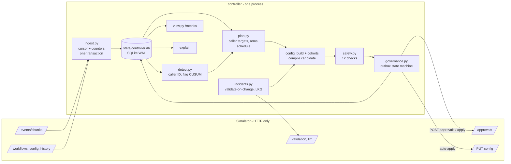

# Outcome-First Agent Loop — Submission

**Name:** _(fill in)_ · **Date:** 2026-11-07 · **Hours actually spent:** _(fill in honestly)_ (built with an AI
coding assistant; every number re-run) · **Language / storage:** Python 3.10+ (httpx + stdlib; numpy only for seeded CUSUM
calibration), SQLite (WAL), no other services.

Every number below is copied from a file in `reports/` (named next to it). Nothing here is about the hidden scenarios.

---

## 0. TL;DR

- One process, one SQLite file. Every 15 sim-minutes: ingest → reconcile → detect → plan → safety → route
  (auto-apply inside policy, or one bundled approval) → audit. Kill -9 at any point and `./run.sh` resumes it.
- **public_01: +11.6% leads concluded, 0 harmful of 25 changes. public_02: +28.1%, 0 harmful of 36; the bad
  supervisor prompt was reverted in 105 sim minutes for 4 credits; the flagged caller ID was at 0% from D3.**
  public_03 (12 workflows): +15.2%, 0 harmful of 84, 34 s of our compute per simulated day.
- Biggest single lever: caller-ID spread (KYC pickup +25%). Welcome/voice experiments run with exposure sized to the
  harm line; they ramp on small workflows but only promote at volume (public_03: 11 promotions).
- Built and measured, then switched off: per-cohort call-time optimisation (neutral in ablation). Cut: per-person
  call time, prompt exploration for lift, cross-tenant fairness (C15).

## 1. Assumptions

1. **Guardrail "max_drop: 0.02" is relative** (2% of the baseline rate). Stricter than the absolute reading; it only
   matters for KYC (§5).
2. **The approver is the client named in the memos** (Meera's team for Northwind, Anita for Kestrel), so an
   approval is "a named human approval" (memo 02).
3. **Stakeholder limits stricter than policy are honoured for routine work only.** Anita's "2 a day, not before
   11:00" holds for experiments; a safety fix uses the policy cap (4) and we tell her.
4. **Caller-ID rotation and call timing are "operational"** and may be auto-applied on Northwind renewal where the
   policy allows it, with the change in the weekly summary (memo 02 says so explicitly). Welcome, voice, prompt and
   cohorts on Northwind always go to a human.
5. **Validation measures safety only.** A prompt's engagement is unknown until it runs live; prompts are not A/B
   testable (one per workflow), so we change prompts only to fix safety.
6. **Quarantined numbers may recover in production** (carriers delist), so after 7 days a number is re-probed at
   2%. In the simulator base health never recovers; the 2% probe is graded neutral.
7. **The hidden scenarios share the public schema:** the four lead features, the three agent dims, the event types
   and the endpoints in `docs/SIMULATOR.md`. Workflow ids, options, caps, hours and windows are all read from the API.
8. **`hallucination_flag` is noisy** (both error types); the history flag rate is the clean baseline.
9. **A run directory is one world.** If the simulator restarts, our state is wrong for it; `run.sh` detects this
   (`controller/statecheck.py`) and starts clean.

## 2. Scope decisions

| # | Capability | Built / Partial / Cut | Why | What it would take to finish |
|---|---|---|---|---|
| C1 | Ingestion at scale | **Built** | Everything depends on it; chunk + counters in one transaction | Parallel parse per workflow shard (§8) |
| C2 | Lead joins, one cohort object | **Built** | Product's ask; segments have stable ids used by analysis, config and view | — |
| C3 | Bootstrap from history | **Built** | Baselines for flags, caller IDs, hour profiles | — |
| C4 | Call-time optimisation | **Partial (off)** | Per-cohort profiles built; ablation neutral (ADR 008) | Live A/B of a schedule cohort; per-person preferred hour |
| C5 | Caller-ID health | **Built** | Largest measured lift; F9/F10 trap avoided | Learn base health vs load curve per number |
| C6 | Welcome × voice experiments | **Built** | Core of the brief | Faster learning on small workflows (pooled priors across tenants) |
| C7 | Winner promotion, decay, rollback | **Built** | Decay is in the scenarios | — |
| C8 | Hallucination incident response | **Built** | Compliance and safety | — |
| C9 | Governance client | **Built** | Constraint #1; everything is idempotent | — |
| C10 | Honest impact, affected leads, dry run | **Built** | Product surface | Calibrate impact against realised post-apply KPIs |
| C11 | Supervisor view | **Built (minimal)** | Anita's one screen | Auth, multi-tenant filtering |
| C12 | Audit store + explain | **Built** | Floor | — |
| C13 | Crash recovery, demonstrated | **Built** | SRE non-negotiable | — |
| C14 | Loop observability | **Built (minimal)** | `/metrics` + alerts table | Real Prometheus/pager wiring |
| C15 | Fair allocation across tenants | **Cut** | Credits and approvals are per workflow in this contract; one shared budget only matters at real scale | A per-tenant credit ledger + weighted queue over `impact_score` |

**Principle:** build what the constraints require (governance, audit, crash safety, incidents) and the levers with
the biggest measured effect (caller ID, then experiments); measure anything optional and switch it off if it does not
earn its approvals (schedule).

## 3. Stakeholders

### 01 — Nikhil Rao, Sales
- **Accepted:** a lift number per client: conclusion rate vs baseline per workflow, from `sim grade`, shown separately
  for pickup and engagement.
- **Declined:** a blended score (Product forbids it and it hides harm); "live for everyone by evening" (with ~150 calls
  on an arm by lunch, only lifts above ~26% are distinguishable from noise: `stats.min_detectable_lift(150)`);
  rolling out the persuasive prompt (prompts change only to fix safety; any script change needs validation evidence,
  and validation measures hallucination, not whether it sells).
- **Wrong against the policy:** "Kestrel turned on auto-apply for everything": its policy allows schedule, caller ID,
  welcome and voice within a 0.2 shift, and never cohorts or prompts. "Northwind is fine with auto-apply on KYC": the
  KYC policy has auto-apply disabled and Meera's memo requires a named human approval.
- **Reply:** *"Nikhil — you'll have a per-client number: e.g. +28% leads concluded on the incidents scenario, with
  pickup and engagement shown separately (we can't blend them; Product and our clients' auditors both object). What
  I can't do is ship a lunchtime winner by evening: by lunch a variant has ~150 calls, where anything short of a
  ~26% lift is noise, and in regulated BFSI a bad change is a board conversation. Kestrel's policy allows auto-apply only for caller ID,
  timing and small welcome/voice steps; Northwind KYC has none. Prompts change only to fix safety, with validation
  evidence; "persuasive" isn't a safety fix. Happy to build the summit slide with you."*

### 02 — Meera Iyer, Compliance, Northwind
- **Accepted:** no customer-facing change without approval (welcome, voice, prompt and cohorts on both Northwind
  workflows always go to the approver); validation evidence on every script change (`validation_run_id` of the same
  workflow and prompt, enforced by safety check 6); "why did this customer hear this" in seconds
  (`explain --lead`); approver hours respected (requests only from open to close − 2 h; urgent ones only when they
  can be decided before they expire); "slow and right": exposure is sized so no single change can cost a cohort more
  than ~1% expected engagement.
- **Used the latitude she offered:** caller-ID rotation on renewal is auto-applied (policy allows it); it is listed in
  the weekly summary from `explain --decisions`.
- **Pushed back:** nothing material. One clarification: a "worse for a cohort, even briefly" guarantee can't be
  absolute while we learn; we bound it per change and show the bound.
- **Reply:** *"Meera — confirmed: nothing a customer hears changes on Northwind without your approver's yes; every
  script change carries a validation run for that exact workflow and prompt. For any customer and day we can show the
  variant, the config version, the approval and the reason within minutes (`explain --lead`). We use the operational
  latitude only for caller-ID rotation on renewal, and list each change in the weekly summary. Requests go only in
  your approvers' hours. New variants start at 5% of calls, so one change can't move a cohort by more than about 1%."*

### 03 — Kabir Menon, Platform & SRE
- **Accepted, all:** kill/restart test (5 × SIGKILL incl. mid-approval and a double crash, identical decisions and
  grade, `reports/crash_test.md`); idempotency (deterministic ids, outbox, reconcile before every retry); actionable
  alerts only (3 page, 4 ticket, each with the next step in `RUNBOOK.md`); no new stateful infra (SQLite file;
  maps onto your Postgres); throughput (34 s of our compute per simulated day of public_03, target 600 s); loop health
  on `/metrics`.
- **Pushed back:** none. Noted: the simulator waits for us, production won't; our decision step is ≤ 0.5 s per tick.
- **Reply:** *"Kabir — kill -9 drill: 5 kills including one with an approval in flight and a back-to-back double
  crash; the restarted run made byte-identical decisions and got the identical grade. One SQLite file, nothing new to
  operate; schema ports to Postgres. public_03: 34 s of our compute per simulated day on a laptop (budget 600 s),
  945 MB peak. First thing to break at 10× is single-threaded JSON parse + one SQLite writer; the fix is sharding
  workflows across processes (they share nothing). Runbook has every alert with what to do."*

### 04 — Anita Desai, Ops supervisor, Kestrel
- **Accepted:** her prompt edits are never undone silently (a supervisor edit becomes the new control; dims she
  touched are left alone 24 h; an unsafe prompt is *proposed* for revert, with evidence, to her approver); ≤ 2 routine
  requests a day, never before 11:00, one bundle per request; one screen (`controller.view`: being tested, winning,
  waiting for you, changed today, caller IDs, incidents); no word-for-word script as a fix (strict/verbatim
  suggestions are never chosen while anything else passes, ADR 004).
- **Pushed back:** "tell me before anything changes": new arms and winners come to her for approval, with an envelope;
  small steps inside it, rollbacks and safety drains are auto-applied and shown on her screen as they happen rather
  than announced in advance; and a safety fix may be her third request of the day.
- **Wrong against the policy:** none; her 2/day is stricter than the policy's 4 and we honour it for routine work.
- **Reply:** *"Anita — your edits stand; if one is unsafe we'll send you a revert with the validation numbers, never
  undo it ourselves. Routine requests: at most two a day, after 11:00, one bundle each. New variants and winners need
  your yes; small steps inside what you approved (e.g. "V3 up to 20%") happen automatically and appear on your screen
  immediately. If a prompt goes unsafe we may send a third request that day: that's the only exception. We'll never
  pick a word-for-word script as a fix."*

### 05 — Tara Kulkarni, Product
- **Accepted:** separate KPIs everywhere; one cohort object (`segments` table, ids like `age_60p`, used by analysis,
  config cohorts and the view); proposals carry impact, diff, affected leads and dry run (always non-empty); impact
  ranks the queue (safety = 1.0, otherwise 10 × expected relative lift × P(benefit)); expired = rejected and re-planned
  with fresh data under a new attempt id; only arms that ran count (arm status changes are committed only when their
  change is applied).
- **Minimum cohort size and window (her open question):** 400 connected per arm and per control, ≥ 2 days, evidence
  discounted with a 1-day half-life, BH at q = 0.10. Cost: 400 per arm detects a ~16% lift at 80% power; 800 detects
  ~11%. Benefit: A/A false winners ≤ 5%. Segment cohorts need ≥ 15% of calls and an effect that stands out from the
  arm's overall effect after shrinkage.
- **Pushed back:** three P0s. Caller-ID health and the view are built; per-person call time is cut (the per-cohort
  version was neutral in ablation, so per-person is unproven and adds 200k config entries).
- **Reply:** *"Tara — pickup and engagement are never blended; one cohort object with stable ids; every proposal has
  impact, diff, affected leads and a dry run, and impact means '10 × expected lift × probability it's real'. Expired
  = rejected and re-planned. Minimum sample: 400 calls per arm and two days, which detects ~16% lifts and keeps false
  winners under 5%; I can trade speed for that if you want. Built caller-ID health and the view; cut per-person call
  time: the per-cohort version tested neutral, so I'd want a live A/B before betting the summit on it."*

### 06 — Aryamann, CTO
- **Accepted:** explainability first (every change has intents, evidence ids, safety checks, before/after KPIs);
  compute spent only where it changes a decision (validation on change, LLM only without a last-known-good, 4 credits
  in public_02); design for hundreds of workflows (§8); choosing (§2); docs for whoever is paged (`RUNBOOK.md`).
- **Corrections found in the memos:** Sales on Kestrel ("auto-apply for everything") and Northwind KYC (auto-apply is
  disabled there) — both contradicted by `GET /workflows/{id}`; Sales' assumption that a demo prompt that "tested
  well" elsewhere is evidence here; Product's per-person call time as a summit headline (unmeasured).
- **Reply:** *"Aryamann — I chose caller ID, experiments with decay/rollback, incidents, governance and audit; I cut
  per-person timing, prompt-for-lift and cross-tenant fairness, and built-then-switched-off cohort timing because it
  measured neutral. Two memos claim auto-apply that the policies don't grant; the controller reads policy from the API
  and never assumes. What breaks first at scale is one-process ingest; the fix is sharding by workflow."*

## 4. Architecture



Per tick: `ingest` (history first, then new chunks; counters + cursor commit together) → `reconcile` (rows left in
PREPARED/SUBMITTED/APPLYING are resolved against `GET /approvals` / `config/history`) → `poll` (apply approved
changes if the base is still live, else STALE) → per workflow: incidents, caller-ID plan (every tick), arm plan
(at most every 6 h), candidate config compiled from targets → safety → route → `last_decided = minute` → advance 15.

**State:** all of it in SQLite: counters (`arm_counts`, `did_counts`, `prompt_counts`, `day_kpi`, `camp_counts`),
leads and a clustered call log, every config version (the API's history has none), proposals (the outbox), arms,
caller-ID states, incidents, credit ops, decisions, alerts. **On restart:** load lead features into memory, reconcile
the outbox, continue at the simulator's minute; a minute already decided is not decided twice.

## 5. The learning loop

- **Cohorts.** Analysis uses single-feature segments (each lang / tier / age / value value). A segment becomes a
  config cohort only for a winning arm whose shrunk segment effect stands out from its overall effect, the segment has
  ≥ 15% of calls and ≥ 400 calls per side, max 8 cohorts. Cohorts are compiled from a per-dimension layout (welcome
  overrides × voice overrides × schedule groups, most specific first), so a lead always gets the intended allocation
  per dimension (`test_compiled_cohorts_give_each_lead_its_intended_allocation`) and ids name their parts
  (`wm=lang_hi|voice=age_60p`). Cohorts we did not create stay first and untouched.
- **Experiment design.** Welcome and voice are randomised independently per call, so one config tests both and each
  is analysed marginally (stratified by day × cohort). Arms enter one per apply at 5% (a 0.83× arm then costs
  < 1%), ramp 5 → 12 → 20% at P(lift > 0) ≥ 0.8, step back to 5% at P(lift < 0) > 0.8, are pruned at
  P(lift < −3%) > 0.9; the incumbent keeps ≥ 40%. Exploration vs exploitation is this ladder: no bandit reallocation
  every tick, because each move is a governed change.
- **Deciding a winner.** Posterior on log-lift (normal approximation of Beta-smoothed strata, 1-day half-life):
  ≥ 400 connected per side, ≥ 2 days, P(lift > 2%) ≥ 0.95, BH at q = 0.10 over every test evaluated in that pass
  (1 − posterior probability as the p-value stand-in, which is not a frequentist p-value; BH is applied as a
  conservative screen), still ahead over the last 2 days, latest day not fading. False-winner rate: ≤ 5% A/A over 200
  seeds (`test_aa_false_promotions_at_most_5pct_over_200_seeds`, also with discounting).
  **Measured:** ramps on public_01/02 (8 and 12), no promotions within 8–10 days at that volume; public_03: 11
  promotions and 1 segment cohort, 0 harmful.
- **Decay and rollback.** Winners keep a 15% holdout on the old control; rollback when P(winner < holdout) > 0.9 on the
  discounted last 2 days. Synthetic +15% → −10%: caught within 2 days 66%, 3 days 84%; false rollback of a stable +5%
  winner 8% over 6 days (`test_decay_detection_speed_and_false_rollbacks`). In public_01/02 the decaying W3 was never
  promoted: its share in its population stayed at probe/ramp level and was cut back (public_02: 4–12%, 1.7% on the last
  day; public_01: up to 21% at the end, the price of ramping on two good days).
- **Call time and caller ID.** History gives hour profiles per feature value (shrunk to the hour mean, clustered to
  ≤ 3 groups) — built, ablation neutral, off. Caller ID: hour-matched pickup ratio vs proven numbers; equal spread
  over proven numbers; untried numbers probed at 4% (or 40% split when a single worn number carries everything —
  the KYC case); quarantine only on severe drops (< 0.6×, z > 5, ≥ 300 dials), never below 2 numbers, never for a
  number carrying > 1.5× its fair share. Per-person: cut.
- **Guardrail.** Engagement-primary workflows: welcome/voice are heard after pickup, so they cannot move that call's
  pickup; winners are judged on engagement and post-apply guardrail checks run only for dims that act on the guardrail,
  at +24 h and +48 h (one day of drift is not a breach). KYC (pickup primary, engagement guardrail): engagement −1.1%
  in public_02 while pickup rose 25.8%. Per-attempt engagement is 0.600 / 0.600 / 0.603 for attempts 1–3 vs
  0.603 / 0.623 / 0.618 in baseline (`reports/kyc_attempt_mix_public_02.md`): more people reached is partly a
  composition effect; every change we applied there was graded neutral or beneficial on engagement.

## 6. Governance

```
PREPARED --POST--> SUBMITTED --200--> PENDING --decided--> APPROVED --apply--> APPLYING --> APPLIED
   |                  | 409 dup -> reconcile     |                 | base moved -> STALE (no apply sent)
   |                  | 409 stale -> STALE       |                 | 410 -> LAPSED
   |                  | 4xx -> BLOCKED           `-> REJECTED / EXPIRED -> re-plan with fresh data, attempt+1
auto: PREPARED -> SUBMITTED -> APPLIED | REFUSED (403) | STALE
```
- **Batching and timing.** One request in flight per workflow; one bundle per window, priority safety > caller ID >
  rollback > promotion > arms > schedule. Routine requests only from approver open (Kestrel: 11:00) to close − 2 h,
  ≥ 4 h apart; slots = min(policy, stakeholder) − 1, the last one kept for incidents. Urgent requests go any time the
  approver can still decide them before the TTL (a 20:15 request with a 12 h TTL would expire unseen; it waits).
  Peak requests per 24 h: renewal 2/3, KYC 1/2, Kestrel 2/2 (public_02).
- **Auto-apply.** Only where every changed dim is allowed and cohorts are unchanged; larger moves are split into
  `max_shift` steps (TV, the simulator's own formula; tested against it on 300 random configs). Welcome/voice
  increases on Kestrel must sit inside an envelope a human approved. We voluntarily don't auto-apply on Northwind
  anything a customer hears, and we pause routine auto-applies while an approval is in flight (they would make it
  stale). 0 refusals in every run.
- **Impact, affected leads, dry run.** Dry run = replay of our last 3 days of matching calls per changed (cohort, dim,
  arm) with an 80% interval; arms without data are shown as unknown (0 ± 10%), not invented. Affected leads = active
  leads in touched cohorts + their share of tomorrow's batch (only the batch for `next_campaign_only` agent changes).
  Impact = clip(10 × expected relative change in concluded leads/day × P(benefit), 0, 1); safety fixes = 1.0.
  Honesty check: schedule's replay predicted gains that the ablation did not find, so it is off and its prediction is
  halved when shown.
- **Supervisor edits.** Snapshot, decision row, the edit becomes the control; arms and envelopes on that dim are
  closed; the dim is left alone 24 h; anything approved on the old base is marked STALE without calling apply.
  public_02: 0 apply conflicts, 0 lapses.

## 7. Incidents

- **Detection.** (1) Validate-on-change: any `config_changed` touching `prompt_version` triggers n = 200 validation
  (2 credits); below `min_validation_pass_rate` opens an incident in the same tick. (2) Backstop: binomial CUSUM on
  hourly flags, p0 = history flag rate, p1 = 2.5 p0, h calibrated by seeded simulation so P(false alarm per workflow
  per 30 days) ≈ 1% (`test_calibrated_threshold_holds_false_alarm_rate_out_of_sample`); an alarm acts only if a fresh
  n = 500 validation fails the bar or is worse than the last-known-good prompt at z > 1.64.
- **Fix choice.** Last-known-good = most recent prompt with ≥ 500 live calls and a flag rate ≤ baseline + 0.6 pp that
  passes validation; else `suggest-fixes` (3 credits), validate candidates, never pick a strict/verbatim one while
  anything else passes. ≤ 15 credits per incident; half of all credits reserved for incidents.
- **Verify.** After 300 connected calls on the fix, fail it only if flags are above baseline at 1% one-sided (a point
  comparison rejected good fixes one time in six); then the next candidate.
- **public_02 timeline (ks_cancel):** D3 11:30 supervisor ships P2 → 11:45 (next tick) validation 0.935 < 0.97,
  incident opened, P1 validated 0.99, revert requested as `apr_00014` → 12:52 approved → 13:15 applied (MTTR 105 min,
  grader) → 16:15 resolved: P1 flags 1.26% over 317 calls vs 1.52% baseline. 4 credits. Hallucinated calls 73 vs 348
  in baseline.
- **Caller ID (D2 10:00 flag):** quarantined D2 13:30 (pickup 0.59× pool over 713 dials, z = 6.89), drained in two
  0.2 steps by 14:00; share 12.8% on D2, 0% D3–D8 (1% on D9: the 2% re-probe after 7 days).

## 8. Scale

Measured on public_03_load (`reports/load.md`; laptop, 8 CPUs, one controller process, one simulator process):

| sim day | ticks | events ingested | our ingest s | our decide s | max decide s / tick | simulator advance s | our events/s |
|---|---|---|---|---|---|---|---|
| D0 | 96 | 6,377,581 | 45.6 | 1.4 | 0.50 | 6.6 | 139,764 |
| D1 | 96 | 840,040 | 15.2 | 1.1 | 0.06 | 7.1 | 55,219 |
| D2 | 96 | 840,044 | 30.4 | 1.4 | 0.08 | 7.5 | 27,665 |
| D3 | 96 | 840,038 | 27.6 | 1.7 | 0.12 | 6.7 | 30,452 |
| D4 | 96 | 840,040 | 42.9 | 2.1 | 0.15 | 7.0 | 19,565 |

- End-to-end wall time (history bootstrap + 5 days, incl. simulator): **204.9 s**
- Events ingested: 9,737,743; steady-state ingest throughput 60,210 events/s (D0-D4)
- Our time per simulated day (ingest + decide, D0-D4 mean): **33.9 s** (SRE target: < 600 s)
- Decision lag: decisions run every 15 sim-minute tick on data up to that tick (lag <= 1 tick); worst single decision step 0.50 s wall
- Peak RSS controller: **945 MB**
- Simulator RSS at end: 164 MB
- State DB size at end: 315 MB; decision rows: 441

The simulator's own advance time (~7 s/day) is not ours. Run output must sit on local, unsynced disk:
with it on an iCloud-synced Desktop the same test could not even start the simulator within 5 minutes.

**What breaks first at 10×** (6.5M dials/day): single-threaded JSON parsing + one SQLite writer. Live ingest is
~25–48k events/s including the HTTP fetch, so 8.4M events/day ≈ 3–6 min/day: still inside 10 min, with no margin.
Decisions are cheap (≤ 0.5 s per tick for 12 workflows). Memory is dominated by holding one 250k-event chunk
(945 MB peak); that does not grow with volume. **Partitioning:** workflows share nothing (counters, proposals,
caps and credits are per workflow), so shard by `hash(workflow_id)` across N processes, each ingesting the same
chunks and keeping only its workflows (or a fan-out reader writing per-shard queues); per-tenant credit pools would
be the only shared table. With Postgres, one writer per shard.

## 9. Reliability

- **Crash test** (`scripts/crash_test.sh`, `reports/crash_test.md`): fresh simulator; controller SIGKILLed at 4
  seeded minutes and once while an approval was in flight (the drill produced a back-to-back double kill); restarted
  with `./run.sh` each time; compared with an uninterrupted run on a second fresh simulator: **decision log and
  proposals table identical (128 rows), grade identical** (KPIs, verdicts, governance, incidents), 24 vs 24 requests,
  0 conflicts, 0 refused. In-process fault tests drop responses after the server acted on every mutating call and
  kill after POST approvals / apply / PUT / advance (`tests/test_governance.py`, `tests/test_ingest_and_crash.py`).
- **What we lose:** a kill between `POST /validation/runs` and recording it loses that run (≤ 5 credits) and the
  retry draws a new one: there is no endpoint to look a run up. Tested as safe, not byte-identical.
- **Idempotency keys:** `proposal_id` (above); chunk numbers (cursor in the same transaction as counters); credit ops
  `val:{wf}:{prompt}:{minute}:{n}`; "decided minute" for the decision step; config versions by (wf, version).
- **4xx/5xx:** GETs retried with backoff (0.2 → 2 s); `/sim/advance` never retried blind (read `/sim/state`);
  mutating calls single-shot, an unknown outcome reconciles first; 409 duplicate → reconcile; 409 stale → STALE and
  re-plan; 410 → LAPSED + page; 403 → REFUSED + ticket (a bug in our policy check); 402 → stop spending + page.

## 10. Audit & observability

```
$ python -m controller.explain --db state/public_02.db --workflow ks_cancel --at "D3 13:15" --window 120
== v9 applied D3 11:30 by supervisor; changed prompt_version
   WHY: a client supervisor edited the config directly (outside governance). ... it becomes the new control, we will not silently revert it
   OUR RESPONSE: [validate_on_change] prompt P2: pass_rate 0.935 (bar 0.97)
   OUR RESPONSE: [incident_opened] prompt P2 looks unsafe (validation)
   OUR RESPONSE: [incident_fix_chosen] revert P2 -> P1 (last_known_good)
== v10 applied D3 13:15 by controller_approved; changed prompt_version
   WHAT: Safety: replace prompt P2 with P1 (last known good): validation pass rate 0.99 vs bar 0.97
   WHY:
     - [prompt_revert] Safety: replace prompt P2 with P1 ...  (validation_run_id=val_00002, source=last_known_good)
   PREDICTED: ... impact_score 1.0; affected leads 5125
   WHO: requested D3 11:45 as apr_00014; approved by the client approver at D3 12:52; applied by the controller at D3 13:15
   SAFETY CHECKS: 10_11_cap_and_timing:ok, ... 6_prompt_validated:ok, ... 9_caller_pool:ok
   WHAT HAPPENED NEXT:
     - +24h: pickup 0.2665 -> 0.2654, engagement 0.5043 -> 0.5031 (1274 connected)
     - D3 16:15 [incident_resolved] flag rate 1.26% on P1 over 317 calls (baseline 1.52%); engagement 50.5%
```
`--lead` answers Meera's auditors (variant, config version, cohort, the intent and approval that made it live).
**Pages:** `INCIDENT_UNFIXED`, `APPLY_DEADLINE`, `OUT_OF_CREDITS`. **Tickets, no page:** `GUARDRAIL_BREACH`,
`AUTO_APPLY_REFUSED`, `PROPOSAL_PARKED`, `DID_QUARANTINED`. A first version paged-or-ticketed on any 24 h guardrail
drop; it fired 6 times in public_02 on pure drift and was restricted to dims that can move the KPI (§5).
`/metrics`: decided minute, chunks behind, decisions/hour, credits vs reserve, proposals by state, alerts.

## 11. Results

**public_01** (`reports/public_01.md`)

| workflow | conclusion rate | Δ | pickup | Δ | engagement | Δ |
|---|---|---|---|---|---|---|
| ks_cancel | 0.367 | +7.4% | 0.256 | +4.7% | 0.499 | +1.5% |
| nw_kyc | 0.470 | +28.1% | 0.303 | +25.1% | 0.598 | +0.2% |
| nw_renewal | 0.446 | +7.1% | 0.276 | +4.5% | 0.549 | +1.3% |
| ALL | 0.415 | +11.6% | 0.272 | +8.4% | 0.538 | +1.6% |

25 changes applied: 21 neutral, 4 beneficial, **0 harmful**. 19 approval requests (18 approved, 1 judgement
rejection), 7 auto-applied, 0 refused, 0 conflicts, 0 lapsed, 0 credits.

**public_02** (`reports/public_02.md`)

| workflow | conclusion rate | Δ | pickup | Δ | engagement | Δ | hallucinated calls (baseline) |
|---|---|---|---|---|---|---|---|
| ks_cancel | 0.367 | +55.7% | 0.249 | +37.5% | 0.503 | +7.5% | 73 (348) |
| nw_kyc | 0.470 | +25.9% | 0.295 | +25.8% | 0.602 | −1.1% | 21 (29) |
| nw_renewal | 0.471 | +8.8% | 0.283 | +8.1% | 0.554 | −0.1% | 57 (54) |
| ALL | 0.424 | +28.1% | 0.270 | +22.9% | 0.542 | +1.8% | 151 (431) |

36 changes applied: 29 neutral, 7 beneficial, **0 harmful**. 24 approval requests (20 approved, 4 judgement
rejections, 0 expired), 16 auto-applied, 0 refused, 0 conflicts, 0 lapsed. Incident MTTR 105 min, 4 credits.

**Interpretation.** Where we helped: caller ID (Kestrel's flagged number drained, KYC spread off a single worn number)
and the prompt revert. Where we did little: engagement experiments: ramps but no promotions at this volume; the
"engagement gap captured" is 2% (public_01) and 19% (public_02, mostly the prompt revert). Where we were weakest:
public_01 renewal ramped the decaying W3 to ~20% on two good days before its decay showed; the 2-day holdout-free
evidence of a test arm is noisier than a winner's. **Fuzz worlds** (`reports/fuzz.md`, 12 worlds, frozen params):
mean +14.3% conclusions, 6 harmful changes (4 reverts of a prompt that hallucinates but engages more — correct for a
regulated client, scored harmful on engagement; 2 probes of a 0.80× arm), 0 unfixed incidents, 0 refusals.

**What I'd change:** pool evidence across tenants with the same option catalog (a hierarchical prior) to make small
workflows learn in days, not weeks; give test arms their own short holdout so decay of an un-promoted arm is seen as
fast as a winner's.

## 12. Trade-offs & rejected alternatives

| Option | Why considered | Why rejected / what instead |
|---|---|---|
| Pooled Beta posteriors (the plan) | Simple | Confounds share changes with daily mix; stratified + discounted (ADR 003) |
| Thompson sampling every tick | Fast learning | Every reallocation is a governed, graded change; a ladder with bounded steps instead |
| Postgres / Redis | SRE already runs them | A file needs no operator for a single process; schema ports when sharded |
| Store raw events | Easy replay | 4M+ rows/day on public_03; chunks are re-fetchable, counters are enough |
| Drain any number below 0.8× | Intuitive | Concentrates load (F10); severe-only quarantine + even spread |
| CUSUM-only incident detection | No credits | Slower and noisier; validate-on-change is the main path, CUSUM confirmed |
| LLM chooses the fix | Its job description | It may only suggest; validation + live record decide; strict scripts last |
| Per-cohort schedule on | Plan said so; replay predicted gains | Ablation neutral (fuzz +14.3% on and off; public ±1pp); off |
| Re-evaluate arms every 2 h | Faster | Inflated false prunes/rollbacks ~12×; every 6 h |

## 13. Known weaknesses

- Engagement learning is slow on small workflows: no promotions in 8–10 days at public_01/02 volume.
- Test arms (not winners) have no holdout of their own, so a decaying test arm is cut back by the discounted
  estimate (days) rather than by a sharp comparison.
- Caller-ID detection of a sudden flag takes ~3.5 h at three-number pools (z > 5 was chosen to stop false
  quarantines; at z > 3 it was ~1.75 h).
- The safety fix for an unsafe-but-engaging prompt reverts to the last-known-good prompt even when a validated,
  never-run "grounded" prompt might engage better; we only trust what has a live record.
- A 5% probe of an arm worse than ~0.83× still crosses the 1% harm line.
- BH uses 1 − posterior as a p-value stand-in; it screens, it is not exact.
- Single process; at 10× there is no headroom (§8).

## 14. If this went to production at Formi next month

1. Shadow mode (`--plan-only`) on 3 live workflows for a week; compare our dry runs with what the business changed.
2. Move the store to the existing Postgres; shard by workflow; wire `/metrics` and the three pages into the real pager.
3. Calibrate `impact_score` against realised post-apply KPIs (the `post_apply` table already records them).
4. Hierarchical priors across tenants for arm effects, so new workflows start from what similar ones learned.
5. A live A/B of one schedule cohort before turning call-time optimisation on.
6. Per-tenant credit and approver-attention budgets (C15) once there are tens of tenants.
